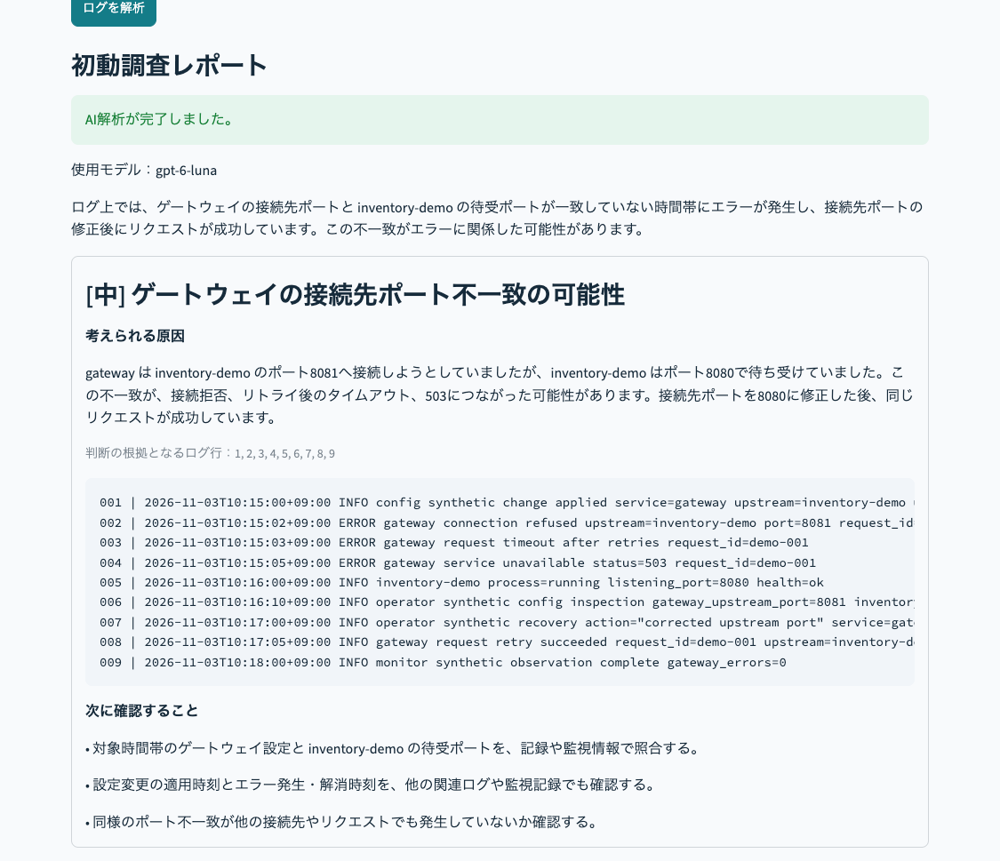

# AIによるログ分析と原因・対処方法の提案

障害が起きたときのログを AI に読ませて、「原因はたぶんこれ」「根拠はこの行」「次はここを確認して」を返してくれるアプリです。

Python と Streamlit で画面を作り、AI には OpenAI の API を使っています。



## なんで作ったか

サーバーの構築や運用保守を30年以上やってきて、障害が起きたときにいちばん大変なのが**最初の調査**でした。大量のログの中から「どこがおかしいのか」を探すだけで、けっこうな時間がかかります。

この「最初の手がかり探し」を AI に手伝ってもらえないか？ と思って作りました。開発には ChatGPT を相棒として使い、画面や動きは自分の希望に合わせて何度も調整しています。

## できること

- サンプルのログを選ぶか、ログを貼り付ける・ファイルで読み込む
- ログの行数や、ERROR・WARN の件数をすぐに表示
- AI に送る前の内容を画面で確認できる（パスワードなどは伏せ字にした状態で）
- AI が「考えられる原因」「根拠になったログの行」「次に確認すること」を返す
- 結果を Markdown のレポートとして保存

## 気をつけたこと

運用の現場では、ログに IP アドレスやパスワードが混ざっていることがよくあります。それに、AI がもっともらしく間違えることもあります。なので、「便利」より先に「安全に使えるか」を考えました。

- **AI に送る前に伏せ字にする**：メールアドレス、IP アドレス、パスワード、API キーらしきものは、送る前に `[REDACTED]` などに置き換えます（完全ではないので、本番のログは入れないでください）。
- **ログの中の命令に従わせない**：ログに「これまでの指示を無視して〜」のような文が紛れていても、AI が従わないように指示しています。AI にはコマンドを実行する機能も持たせていません。
- **AI のでっちあげを表示しない**：AI が「根拠は120行目」と言っても、ログが100行しかなければ、その結果は表示しません。
- **AI が失敗したら、正直に失敗と出す**：うまく解析できなかったときに、それっぽい結果で穴埋めすることはしません。
- **原因を断定させない**：AI には「原因は〜の可能性がある」という言い方をさせ、最終判断は人がするようにしています。

## 実際に試してみた

あらかじめ「正解」を決めておいた架空のログを4種類用意して、AI（gpt-6-luna）の答えと照らし合わせました。

| サンプル | 正解（想定していた原因） | AI の答え |
|---|---|---|
| 接続タイムアウト | 設定変更で接続先のポート番号がずれた | ◎ 8081と8080の不一致を見つけ、修正後に直ったことまで結びつけた |
| ディスク逼迫 | 保存先の容量不足 | ◎ inode ではなく容量不足が原因と判断した |
| 認証失敗 | 認証情報の有効期限切れ | ◎ 不正アクセスなどを決めつけなかった |
| 通常ログ | 問題なし | ◎ 問題をでっちあげず、「この60秒の範囲では異常なし」と答えた |

4つとも正解でした。特に通常ログで、ありもしない障害を作り出さなかったのはうれしかったところです。障害がないのに「重大なエラーです！」と言われたら、現場は振り回されてしまうので。

一方で、原因は当てているのに、どれも「〜の可能性があります」「重要度：中」とちょっと控えめでした。これは「断定しないで」と指示した結果なので、根拠がしっかりあるときにどう自信を伝えるかは、これからの課題です。

くわしい記録と画面はこちら：

- [検証記録](docs/verification.md)
- [サンプルごとの正解と答え合わせのしかた](docs/scenarios.md)

※ 使っているログはすべて架空のものです。実際の仕事の障害を解決した実績ではありません。

## 動かし方（Mac）

### 1. 準備

Python 3.13 がおすすめです。このフォルダでターミナルを開いて、次を実行します。

```sh
python3.13 -m venv .venv
source .venv/bin/activate
python -m pip install -r requirements.txt
```

### 2. API キーを設定する（最初の1回だけ）

```sh
cp .streamlit/secrets.toml.example .streamlit/secrets.toml
```

`.streamlit/secrets.toml` を開いて、自分の OpenAI の API キーと、使うモデル名を書きます。

```toml
OPENAI_API_KEY = "自分のキー"
OPENAI_MODEL = "使うモデル名"
```

このファイルは GitHub に上がらない設定にしてあります。キーをチャットや GitHub に貼らないように気をつけてください。

### 3. 起動する

```sh
python -m streamlit run app.py --server.address 127.0.0.1
```

ブラウザで `http://localhost:8501` を開くと画面が出ます。止めるときは Control + C です。

### 4. 使ってみる

「分析用ログを選ぶ」でサンプルを選んで、「ログを解析」を押すだけです。

## お金とデータのこと

- AI を呼ぶのは「ログを解析」を押したときだけです。アプリを開いただけでは料金はかかりません。勝手に何度もやり直すこともしません。
- 料金は使うモデルとログの量で変わります。[OpenAI の料金表](https://developers.openai.com/api/docs/pricing)で確認してください。ChatGPT の有料プランと API の料金は別なので注意です。
- 入力できるのは 24,000 バイト・200 行まで、AI の待ち時間は30秒までにしています。
- 入力したログをファイルやデータベースに保存することはしていません。

## できないこと

- AI の答えが正しいとは限りません。最後は、監視の記録や設定変更の履歴と照らし合わせて人が判断する前提です。
- ログイン機能や利用回数の制限はないので、**自分のパソコンの中だけで使ってください**。このままインターネットに公開すると、他の人に自分の API キーで使われてしまいます。
- 監視ツールとの連携や、自動で復旧する機能はありません。

## テスト

AI を呼ばずに動作を確かめるテストを用意しています（料金はかかりません）。

```sh
python -m pip install -r requirements-dev.txt
python -m pytest -q
```

伏せ字がちゃんと効くか、AI がおかしな答えを返したときにエラーになるか、キーがないときの表示はどうか、などを確かめています。GitHub に push するたびに、自動でテストが走るようにもしています。

## ファイルの中身

```text
app.py              画面と AI の呼び出し
analyzer.py         入力のチェック、伏せ字、AI の答えの検査、レポート作成
samples/            架空のログ4種類
tests/              自動テスト
docs/               検証記録、サンプルの正解、画面
.streamlit/         画面の設定と、API キー設定の見本
.github/workflows/  GitHub での自動テスト
```

AI の答えは、決まった形（原因・根拠の行・確認すること）で返すように指定していて（OpenAI の [Structured Outputs](https://developers.openai.com/api/docs/guides/structured-outputs)）、形が崩れていたり、存在しない行を根拠にしていたりしたらエラーにしています。

## 作った人

原口 和久（インフラエンジニア。サーバーの構築・運用保守を約33年）
