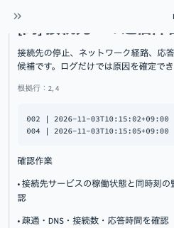

# 検証記録

検証日：2026-11-02（日本時間）

- macOS / Python 3.13.5
- streamlit: 1.66.1
- openai: 2.54.0
- pydantic: 2.14.2
- pytest: 9.2.0
- `python -m pytest -q`：17 passed
- Streamlit起動と `/_stcore/health`：ok
- ブラウザで接続タイムアウトのデモを実行。原因候補と根拠行2・4を確認
- `demo.jpg`：実アプリの小幅ブラウザ表示から撮影した結果の一部。デザインモックではありません
- OpenAI実API呼出し：未実施。APIキーの確認・取得・利用料金の支払いは行っていません
- GitHubアップロード・Webホスティング：未実施

インストール先に対する環境側の書込み制限があったため、検証には一時フォルダの仮想環境を使用しました。成果物に仮想環境は含めていません。

## 自分でスクリーンショットを追加する

通常のブラウザでアプリを開き、解析後にMacの Shift+Command+4 で範囲を選択して撮影してください。キー・secrets設定・実務ログが写っていないことを確認し、docsに追加できます。

## 画面改善後の確認

AI解析完了の表示、応答IDなどの接続記録、同意前のボタン無効化、失敗時に成功表示が出ないことを模擬応答で確認しました。実APIの動作確認は引き続き別途必要です。demo.jpgは改善前の画面です。

ディスクの合成ログを障害発生から復旧までの8行に変更。実APIでの原因説明の正確さは未検証です。

## 全サンプルのシナリオ更新

接続タイムアウトを接続先ポート不一致からの復旧、認証失敗を資格情報の期限切れからの復旧、通常ログを60秒間の観測記録に更新しました。容量不足を含む4種類に画面上の状況説明を追加し、想定正解と根拠行をdocs/scenarios.mdに整理しました。

更新後のテスト：17 passed。デモの根拠行は接続2・3・4、容量2・3・4、認証2・3。旧スクリーンショットと以前の接続デモ記録は更新前のサンプルを示しています。実APIでの各シナリオの回答品質は未確認です。

## 2026-11-03：画面の簡素化・AI解析専用化

- 指定タイトルに変更。Deploy・メニューを非表示にするCSSを追加
- 左側の設定、モード切替、シナリオ説明、送信同意欄、接続記録、フッターを画面から削除
- AIへの入力プレビュー、個人情報・機密情報の注意、解析完了とモデル名を維持
- API未設定・失敗時はエラー表示。ルールへの自動切替なし
- API模擬応答を使った自動テスト：18 passed（課金なし）
- 実APIはこの更新作業で呼び出していません
- ブラウザでの確認用サーバー起動は実行環境の通信制限で不可。今回の確認はStreamlit AppTestによるものです
- 以前のdemo.jpgは旧画面の記録であり、現在のREADMEでは掲載していません
- 既存のsecrets.tomlは変更していません。旧ENABLE_LLM設定は参照されません
