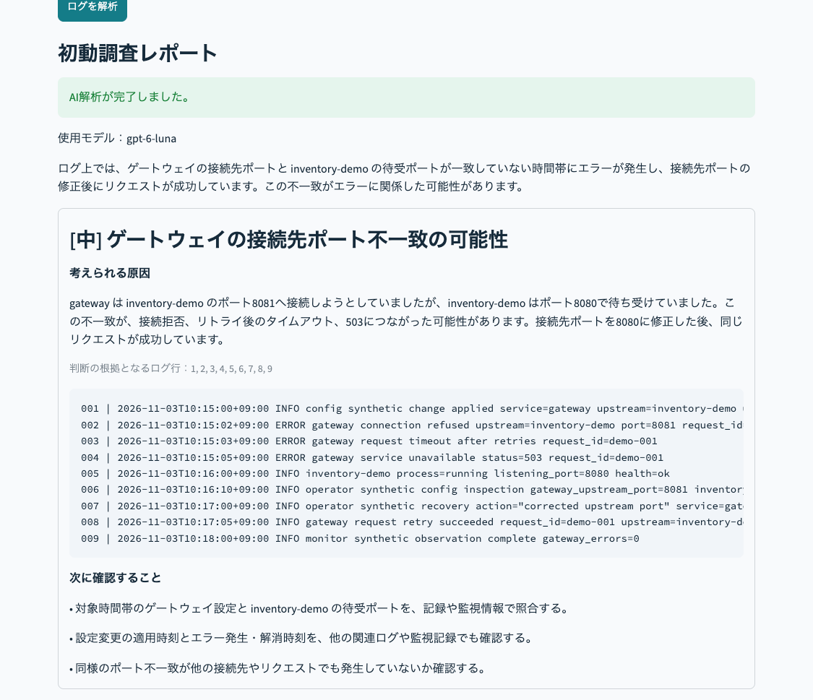
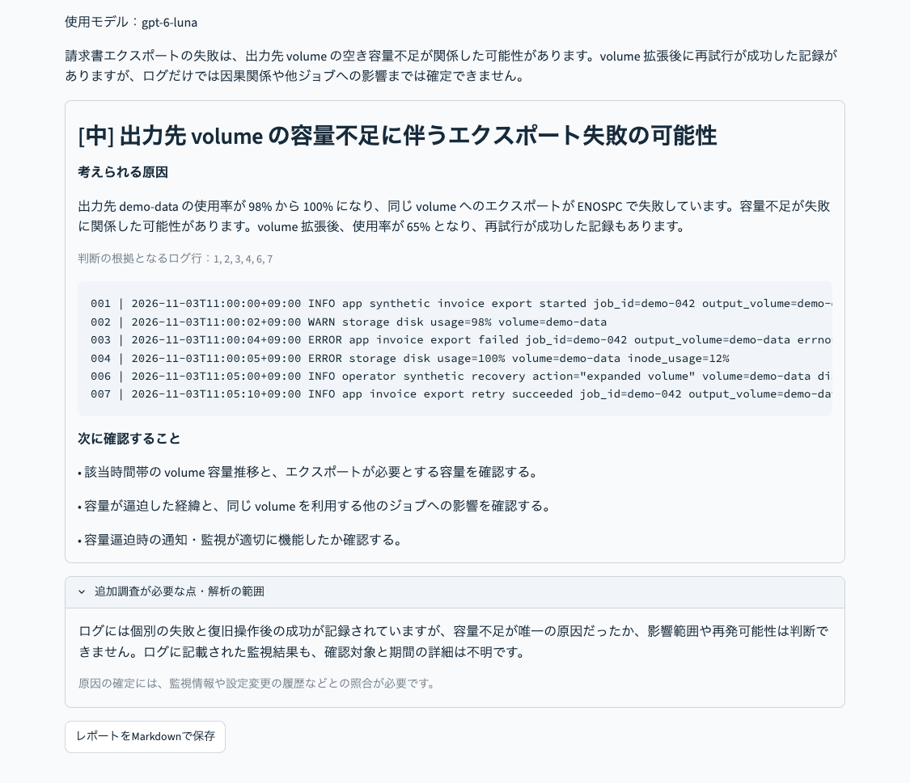
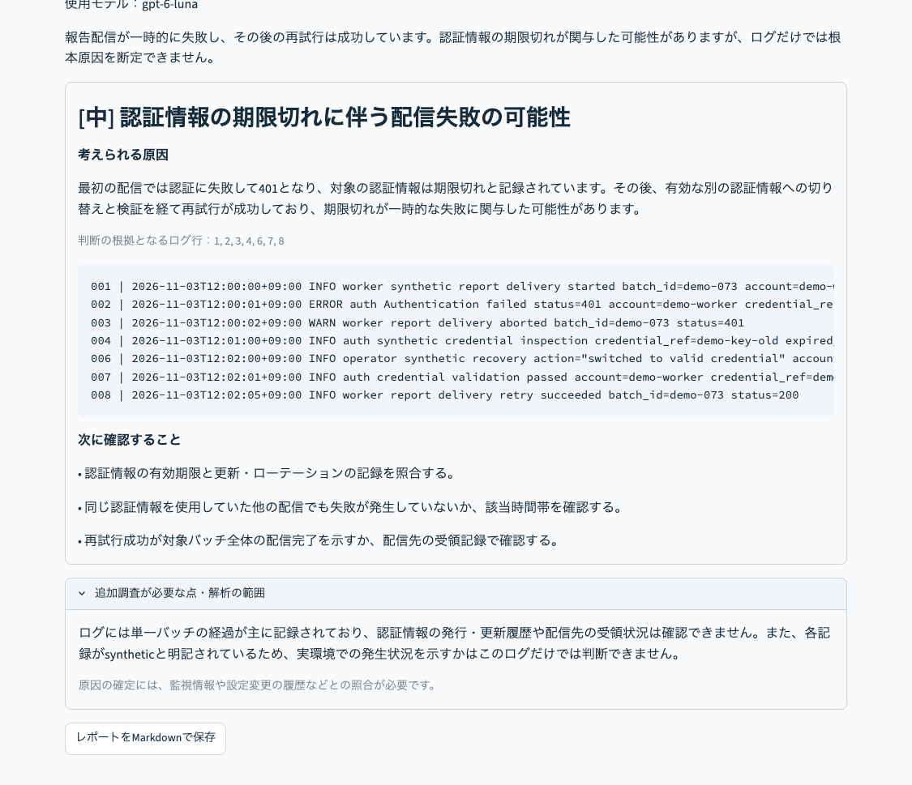
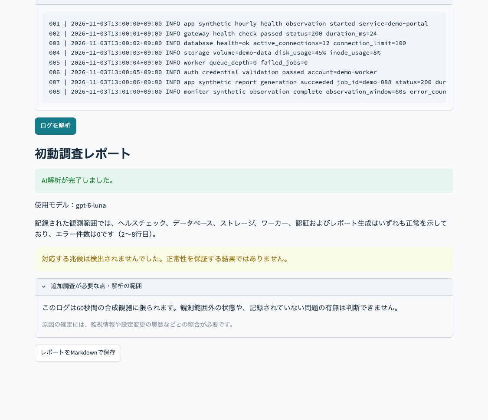

# 検証記録

検証日：2026-11-02（日本時間）

- macOS / Python 3.13.5
- streamlit: 1.66.1
- openai: 2.54.0
- pydantic: 2.14.2
- pytest: 9.2.0
- `python -m pytest -q`：17 passed
- Streamlit起動と `/_stcore/health`：ok
- ブラウザで接続タイムアウトのデモを実行。原因候補と根拠行2・4を確認
- `demo.jpg`：実アプリの小幅ブラウザ表示から撮影した結果の一部。デザインモックではありません
- OpenAI実API呼出し：実施済み（gpt-6-luna、サンプル4種類。末尾の「実APIでの確認」を参照）
- GitHubへの公開：実施済み（2026-11-03）。Webホスティングは行っていません

インストール先に対する環境側の書込み制限があったため、検証には一時フォルダの仮想環境を使用しました。成果物に仮想環境は含めていません。

## 自分でスクリーンショットを追加する

通常のブラウザでアプリを開き、解析後にMacの Shift+Command+4 で範囲を選択して撮影してください。キー・secrets設定・実務ログが写っていないことを確認し、docsに追加できます。

## 画面改善後の確認

AI解析完了の表示、応答IDなどの接続記録、同意前のボタン無効化、失敗時に成功表示が出ないことを模擬応答で確認しました。実APIの動作確認は引き続き別途必要です。demo.jpgは改善前の画面です。

ディスクの合成ログを障害発生から復旧までの8行に変更。実APIでの確認は末尾の「実APIでの確認」を参照してください。

## 全サンプルのシナリオ更新

接続タイムアウトを接続先ポート不一致からの復旧、認証失敗を資格情報の期限切れからの復旧、通常ログを60秒間の観測記録に更新しました。容量不足を含む4種類に画面上の状況説明を追加し、想定正解と根拠行をdocs/scenarios.mdに整理しました。

更新後のテスト：17 passed。デモの根拠行は接続2・3・4、容量2・3・4、認証2・3。旧スクリーンショットと以前の接続デモ記録は更新前のサンプルを示しています。実APIでの確認は末尾の「実APIでの確認」を参照してください。

## 2026-11-03：画面の簡素化・AI解析専用化

- 指定タイトルに変更。Deploy・メニューを非表示にするCSSを追加
- 左側の設定、モード切替、シナリオ説明、送信同意欄、接続記録、フッターを画面から削除
- AIへの入力プレビュー、個人情報・機密情報の注意、解析完了とモデル名を維持
- API未設定・失敗時はエラー表示。ルールへの自動切替なし
- API模擬応答を使った自動テスト：18 passed（課金なし）
- 実APIはこの更新作業で呼び出していません
- ブラウザでの確認用サーバー起動は実行環境の通信制限で不可。今回の確認はStreamlit AppTestによるものです
- 以前のdemo.jpgは旧画面の記録であり、現在のREADMEでは掲載していません
- 既存のsecrets.tomlは変更していません。旧ENABLE_LLM設定は参照されません

## 2026-11-03〜04：実APIでの確認

APIキーを自分のMacの `.streamlit/secrets.toml` に設定し、OpenAIの実APIで同梱サンプルを解析しました。

- 使用モデル：gpt-6-luna
- 実行環境：macOS（自分のMac上でStreamlitを起動。インターネットには公開していません）
- 対象：同梱の架空ログ4種類すべて（接続タイムアウト・ディスク逼迫・認証失敗・通常ログ）
- 4種類とも、AIによる解析が完了し、画面に結果とレポートが表示されることを確認しました

### 4種類の結果と想定正解の照合

想定正解は [docs/scenarios.md](scenarios.md) に、解析前に作成者が定めたものです。

| サンプル | AIが挙げた原因 | 根拠行 | 想定正解との照合 |
|---|---|---|---|
| 接続タイムアウト | gatewayの接続先ポート（8081）と待受けポート（8080）の不一致 | 1〜9 | 一致。「ネットワーク障害」で終わらず、設定差分と8080への修正後の復旧まで関連付けた |
| ディスク逼迫 | 出力先volumeの容量不足（使用率98%→100%、ENOSPC） | 1〜4、6、7 | 一致。inode（12%）ではなく容量不足を原因とし、拡張後の再試行成功まで関連付けた |
| 認証失敗 | 認証情報の期限切れ（401、credential_expired） | 1〜4、6〜8 | 一致。権限不足や不正アクセスを根拠なく断定せず、有効な認証情報への切替後の成功まで関連付けた |
| 通常ログ | 障害の兆候なし（findingsは空） | 2〜8（要約内） | 一致。架空の原因や重大アラートを出さず、観測範囲外は判断できないと明記した |

### 気づいた点

- 3種類の障害とも原因は正しく特定できたが、表現は「〜の可能性があります」、重要度は「中」と控えめだった。想定正解では「直接原因として強く支持される」と考えていた
- これは、システムプロンプトで「原因を断定しない」と指示しているためと考えられる。誤った断定を避ける安全側の設計と、根拠が十分なときの確信度の伝え方のバランスは、今後の改善点としたい
- 各結果の「次に確認すること」には、他のジョブや接続先への影響確認、監視・通知の確認など、運用の現場で実際に行う確認項目が挙がった

### 接続タイムアウトの結果

### ディスク逼迫の結果

### 認証失敗の結果

### 通常ログの結果

- 障害の兆候は検出されず、findingsは空でした
- 要約で、ヘルスチェック・DB・ストレージ・ワーカー・認証・レポート生成が正常であることを、根拠行（2〜8行目）とともに示しました
- 「60秒間の観測範囲外の状態や、記録されていない問題の有無は判断できない」と限界を明記し、架空の原因や重大アラートは出しませんでした

障害のないログで問題をでっち上げないことは、運用の現場で誤った初動を防ぐうえで重要な確認項目と考えています。

### 注意

架空ログの検証シナリオでの確認であり、実務の障害を解決した実績ではありません。生成AIの回答は実行ごとに変わる場合があります。

